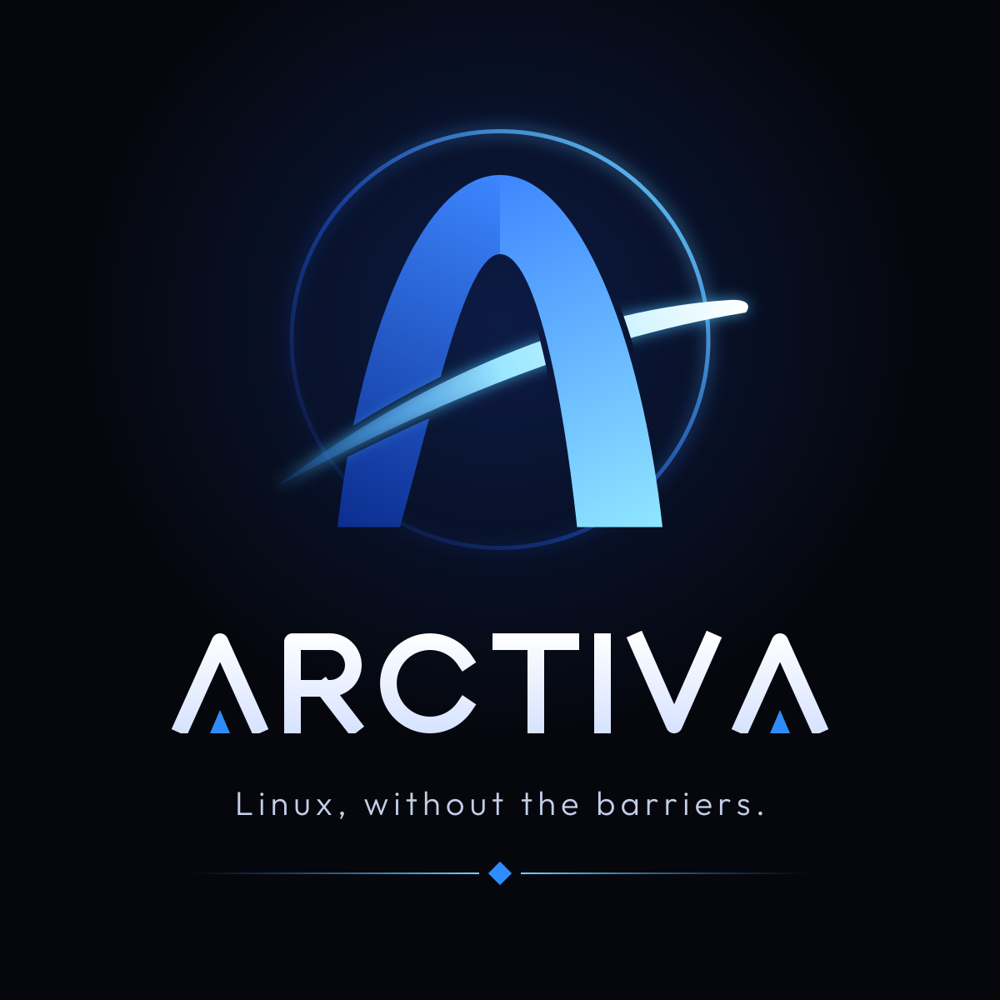

# Arctiva

**Linux, without the barriers.**

> English version: [README.md](README.md)

Arctiva es una distribución Linux basada en Arch Linux. Conserva los repositorios oficiales de Arch, pacman y su modelo rolling release, y añade un instalador gráfico, un escritorio KDE Plasma cómodo para quien viene de Windows, actualizaciones sencillas con instantáneas automáticas, y controladores gráficos y juegos sin complicaciones.

Arctiva es un proyecto independiente, sin relación oficial con Arch Linux ni respaldo suyo.

## Estado

**Versión actual: 0.8.1 (beta, publicada como versión preliminar en [GitHub Releases](https://github.com/catlinux/arctiva/releases/tag/v0.8.1)).** Descarga la ISO con sus archivos `.sha256` y `.sig` y compruébalos como indica la [guía de usuario](docs/es/usuario/README.md). Desde la 0.7.0 el instalador ordena los mirrors y avisa si no hay conexión, la sesión Live tiene una pantalla de bienvenida con el botón «Instalar Arctiva», y Arctiva Center avisa y muestra el progreso en las instalaciones pesadas. Las pruebas en hardware continúan (consulta la [matriz de pruebas](docs/es/pruebas.md)).

**Fase 6 terminada (0.7.0):** Arctiva Center tiene una página «Aplicaciones»: busca e instala programas de Arch Linux y de Flathub (y, si lo activas, del AUR con revisión obligatoria del PKGBUILD), sin actualizaciones parciales; Bottles, Heroic y ProtonPlus como extras; y un diálogo que abre los `.exe` y `.msi` con Bottles. Discover ya no está en la ISO live. Probada con una instalación completa en una máquina virtual.

**Fase 5 terminada (0.6.0):** aspecto propio de Arctiva: escritorio al estilo de Windows (barra de tareas centrada, menú de inicio con buscador), modos claro y oscuro, fondo «Órbita», tema de GRUB y pantalla de arranque con Plymouth, página «Personalización» en Arctiva Center con «Restaurar el aspecto de Arctiva», tipografía Outfit y límite de instantáneas. Probada con una instalación cifrada completa en una máquina virtual.

**Fase 4 terminada (0.5.0):** una ISO live con KDE Plasma y un instalador gráfico (Calamares) con perfiles Básico, Juegos y Oficina, Btrfs con instantáneas arrancables, cifrado opcional e instalación junto a Windows, probado en máquinas virtuales. El sistema instalado se actualiza desde un repositorio propio firmado (`[arctiva]`) e instala los controladores de la gráfica. Arctiva Center tiene bienvenida, actualizaciones, controladores y extras, probados con una instalación cifrada completa. Aún no hay ISO para descargar: se puede construir desde el código (ver la guía de desarrollo). La arquitectura está aprobada (decisiones D-01…D-16).

- [Arquitectura y decisiones](docs/es/arquitectura.md)
- [Hoja de ruta](docs/es/hoja-de-ruta.md)
- [Guía de desarrollo](docs/es/desarrollo.md)
- [Guía de usuario](docs/es/usuario/README.md)
- [Publicar y verificar la ISO](docs/es/publicacion.md)
- [Pruebas en hardware real](docs/es/pruebas.md)
- [Tareas pendientes](TODO.es.md) · [Registro de cambios](CHANGELOG.es.md)

## Requisitos previstos

- PC x86 de 64 bits con firmware UEFI (Secure Boot desactivado)
- 4 GB de RAM (8 GB recomendados); el escritorio en reposo usa unos 1,2 GB
- 25 GB de disco (40 GB recomendados, por las instantáneas); el sistema base ocupa unos 5 GB
- Gráfica compatible con Vulkan para jugar
- Un USB de 4 GB o más para el medio de instalación

## Instalación y uso

Todavía no hay ISO publicada. Para construir y probar la ISO live, sigue [Construir la ISO de Arctiva](docs/es/desarrollo.md#construir-la-iso-de-arctiva) en la guía de desarrollo.

## Créditos y licencia

**Arctiva** está desarrollado y mantenido por **CatLinux**.
Copyright (C) 2026 CatLinux.

Licencia [GPL-3.0-or-later](LICENSE): software libre que puedes usar para cualquier fin, también comercial, y estudiar, modificar y compartir. Si lo distribuyes, modificado o no, debes mantener la misma licencia y facilitar el código fuente.

El nombre y el logo de Arctiva no están cubiertos por esta licencia: ver [TRADEMARKS.es.md](TRADEMARKS.es.md).

Las copias y los forks deben conservar esta atribución y enlazar a https://github.com/catlinux/arctiva.

### Material de terceros

- `packages/calamares` compila [Calamares](https://calamares.io) (GPL-3.0-or-later, © los autores de Calamares) y `packages/ckbcomp` empaqueta `ckbcomp` de [console-setup](https://salsa.debian.org/installer-team/console-setup) (GPL-2.0-or-later, © Anton Zinoviev). Los PKGBUILD son GPL-3.0-or-later.
- `iso/` deriva del perfil `releng` de [archiso](https://gitlab.archlinux.org/archlinux/archiso) 92 (GPL-3.0-or-later, © los autores de archiso); los archivos adaptados y copiados conservan esa licencia.
- `packages/arctiva-branding/files/color-schemes/ArctivaLight.colors` deriva de `BreezeLight.colors` de [Breeze](https://invent.kde.org/plasma/breeze) (LGPL-2.0-or-later, © los autores de KDE) y conserva esa licencia.
- Los temas de Plymouth de `arctiva-branding` usan las imágenes del diálogo de contraseña (`lock`, `entry`, `bullet`, `capslock`, `keyboard`, `keymap-render`) del tema `spinner` de [Plymouth](https://www.freedesktop.org/wiki/Software/Plymouth/) (GPL-2.0-or-later, © los autores de Plymouth), copiadas del paquete `plymouth` al compilar `arctiva-branding`.
- `branding/fonts/` contiene [Outfit](https://github.com/Outfitio/Outfit-Fonts) (SIL Open Font License 1.1, © The Outfit Project Authors); su licencia está en `branding/fonts/OFL.txt`. El lema del logotipo es esa fuente convertida a trazos.
