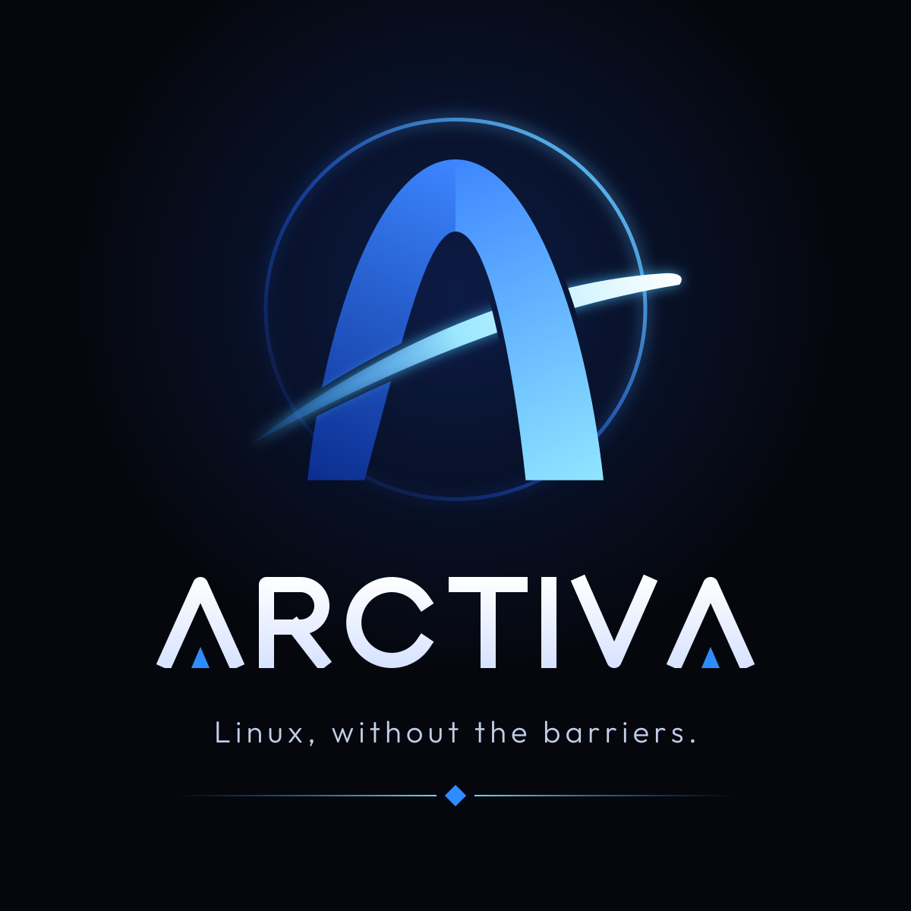

# Arctiva

**Linux, without the barriers.**

> Versión en castellano: [README.es.md](README.es.md)

Arctiva is a Linux distribution based on Arch Linux. It keeps Arch's official repositories, pacman and its rolling-release model, and adds a graphical installer, a Windows-friendly KDE Plasma desktop, simple updates with automatic snapshots, and hassle-free gaming and graphics drivers.

Arctiva is an independent project. It is not affiliated with or endorsed by Arch Linux.

## Status

**Early design stage.** There is no ISO to download yet. The architecture is a proposal under review.

- [Architecture and decisions](docs/en/architecture.md)
- [Roadmap](docs/en/roadmap.md)
- [Development guide](docs/en/development.md)
- [Pending tasks](TODO.md) · [Changelog](CHANGELOG.md)

## Planned system requirements

- 64-bit x86 PC with UEFI firmware (Secure Boot disabled)
- 4 GB RAM (8 GB recommended)
- 40 GB of disk space (64 GB recommended)
- A Vulkan-capable GPU for gaming

## Installation and usage

Not available yet. Instructions will be published with the first live ISO (version 0.2.0).

## Credits and license

**Arctiva** is developed and maintained by **CatLinux**.
Copyright (C) 2026 CatLinux.

Licensed under [GPL-3.0-or-later](LICENSE): free software that you can use for any purpose, including commercial use, and study, modify and share. If you distribute it, modified or not, you must keep the same licence and provide the source code.

The Arctiva name and logo are not covered by this licence: see [TRADEMARKS.md](TRADEMARKS.md).

Copies and forks must keep this attribution and link to https://github.com/catlinux/arctiva.

### Third-party material

This project contains no third-party material.
